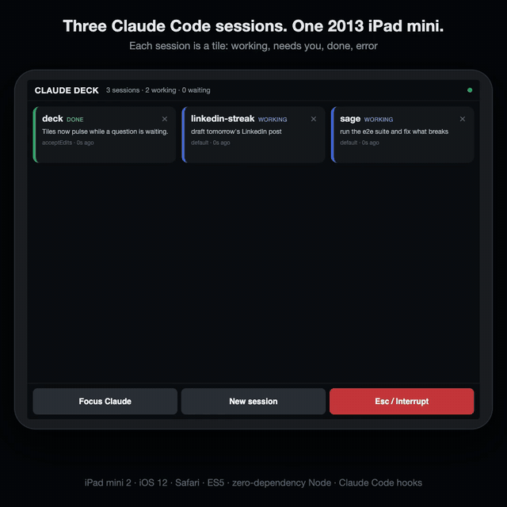
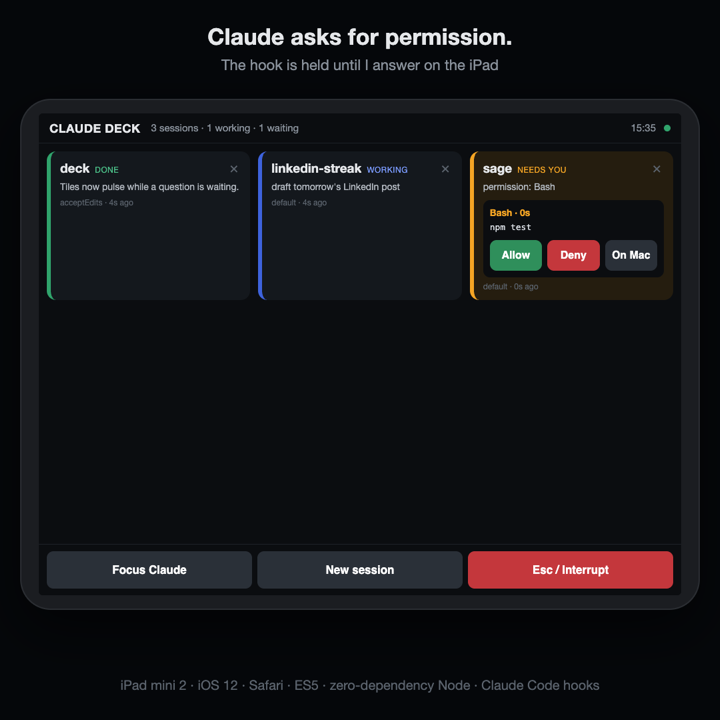
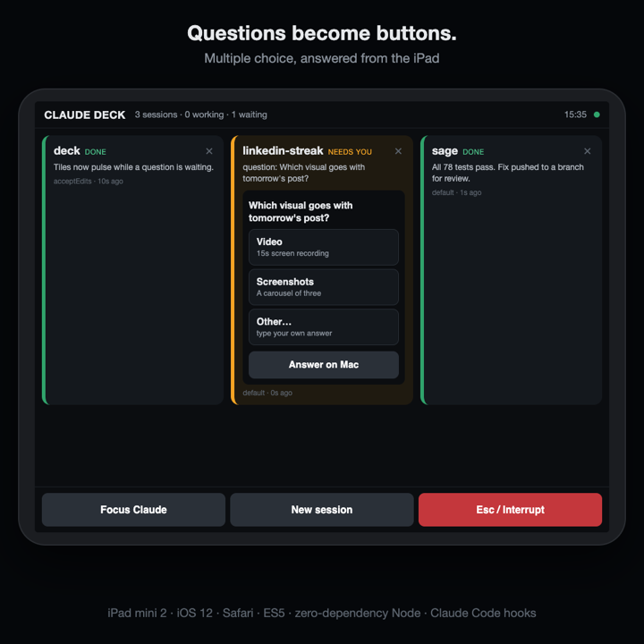

# deck

<p align="center">
  <a href="docs/deck-demo.mp4"></a>
  <br><sub>Click for the full video (22 s). Sessions in the demo are synthetic; the UI and hook responses are real.</sub>
</p>

**A 2013 iPad mini as a stream deck for Claude Code.** Every session is a tile.
When an agent needs a permission or asks a question, it shows up on the iPad
and one tap answers it.

I work across several companies, freelance gigs and customers, each with its
own projects, and several Claude Code agents on each project. Approvals were
the bottleneck: an agent waits on a prompt in a window I'm not looking at, and
nothing moves until I notice. The deck puts all of them in front of me.

The iPad mini 2 is stuck on iOS 12, where modern web apps don't load. So the
UI is plain ES5 for Safari 12, with no build step and no framework, and the
server is a single Node file with zero dependencies.

<p align="center">
  
  
</p>

## Quick start

You need Node 18+ and Claude Code. There's no API key to set: the deck only
sees Claude Code's hook events, and Claude Code keeps its own login.

```sh
git clone https://github.com/metaver5o/deck && cd deck
node server.js            # prints the iPad URL with its token
```

1. Merge [`examples/hooks.json`](examples/hooks.json) into
   `~/.claude/settings.json` (or a project's `.claude/settings.json`). Keep any
   hooks you already have.
2. On the iPad, open the printed `http://<mac-ip>:8787/?t=<token>` (same
   Wi-Fi). "Add to Home Screen" makes it full screen.
3. Start `claude`. Sessions appear as tiles, and permission prompts and
   questions show up as buttons.

### Or run it in Docker

No Node on the host, just Docker:

```sh
git clone https://github.com/metaver5o/deck && cd deck
DECK_URL_HOST=<your-mac-ip> docker compose up -d --build
docker compose logs deck  # the iPad URL with its token
```

Then merge [`examples/hooks.docker.json`](examples/hooks.docker.json) instead
of `hooks.json`. The container uses two ports:

| Port | Published on | Used for |
|---|---|---|
| `8787` | your LAN | the iPad page and its live updates (token required) |
| `8788` | `127.0.0.1` only | Claude Code hooks |

Hooks can't reach a container over loopback, so they get their own port, and
Docker publishes it on the host's loopback only. Other machines on the LAN
can't post hooks. The token lives in the `deck-data` volume and survives
restarts. `~/.claude/projects` is mounted read-only, so the transcript view
works. The macOS extras below (Focus, Esc, chan) need the deck running on the
Mac itself, so they're turned off in the container.

The deck works with Claude Code only, in the CLI and in the Desktop Code tab.
Other agents, such as Gemini CLI, use different hook events and payloads and
aren't supported.

## How it works

```
Claude Code ──HTTP hooks (loopback)──▶ server.js ──SSE──▶ iPad (Safari 12)
     ▲                                     │                    │
     └──── held PermissionRequest ◀────────┴──── POST /decide ◀─┘
```

- Hooks post session events (start, prompt, tool use, stop, errors) to
  `server.js` on loopback.
- The server keeps one tile per session (working, needs you, done or error)
  and pushes the state to the iPad over Server-Sent Events.
- A `PermissionRequest` hook is held open until you tap **Allow**, **Deny** or
  **On Mac**. The server then answers the hook, and Claude continues.
- `AskUserQuestion` also arrives as a `PermissionRequest`. The deck shows the
  options, then answers with `allow` plus `updatedInput.answers`. Multi-select
  answers are joined with ", ".
- Tap a tile to see the end of that session's transcript, plus a compose box.

## Safety

- `/hook/*` accepts loopback only. Everything else (the page, SSE, decisions)
  needs the token in `~/.config/deck/token`, which is created on first run.
- If no iPad is connected, hooks return instantly and Claude Code behaves as
  if the deck weren't there.
- A held permission blocks the agent, so every hold has a timeout. A
  forgotten tile never stalls a session: when the timeout runs out, the prompt
  goes back to the normal desktop dialog.

## Configuration

| Variable | Default | What it does |
|---|---|---|
| `DECK_PORT` | `8787` | Port to listen on (update `examples/hooks.json` to match) |
| `DECK_HOOK_PORT` | off (`8788` in Docker) | A separate port for hooks only, instead of the loopback check |
| `DECK_URL_HOST` | LAN IPs | The host to print in the iPad URL |
| `DECK_PERM_TIMEOUT` | `90` | Seconds to hold a permission before handing it back to the Mac |
| `DECK_QUESTION_TIMEOUT` | `300` | Seconds to hold a question (questions need reading time) |
| `DECK_CS` | `~/.local/bin/cs` | Path to the `chan` terminal CLI (optional) |

## Optional extras (macOS)

- **Reply from the iPad**: sending text works only for sessions running
  inside chan terminals (`cs terminal write --submit claude`). Desktop
  sessions are read-only on the deck. For terminal sessions to show up as
  chan tabs, the hooks also need to send the `X-Chan-Tab`, `X-Chan-Socket`
  and `X-Chan-Window` headers.
- **New session** opens `claude` in a new chan tab, in the last chan window a
  hook reported. Without chan, it presses Cmd+N in Claude.app.
- **Focus Claude** and **Esc / Interrupt** drive Claude.app via `osascript`.
  Esc needs the Accessibility permission for the `node` binary, which you have
  to grant again after Node upgrades.
- **Run as a service**: a LaunchAgent that runs `node server.js`. Restart it
  with `launchctl kickstart -k gui/$(id -u)/<label>`.

## License

MIT. See [`LICENSE`](LICENSE).
